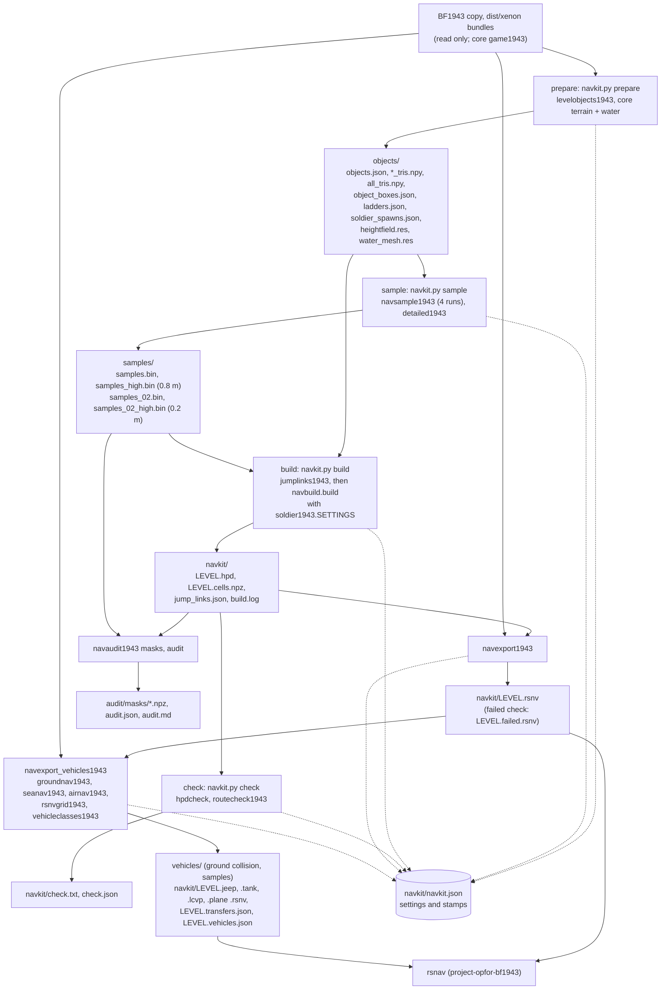

# NavKit: how it is built

This page is for developers who will change NavKit's code. To run NavKit, read [QUICKSTART.md](QUICKSTART.md)
and [README.md](README.md). The format of the navigation file and the builder's stages are described in
[KYNAPSE_SPEC.md](../bf1943-auto-navkit-common/research/KYNAPSE_SPEC.md).

## Overview

NavKit turns one level of a game into navigation data for soldiers. That data is walkable areas, the boundaries
between them, and a route graph. NavKit lives in three folders. This folder, the **big-endian kit**, holds the BF1943
pipeline: the driver `navkit.py`, the window `navkitGUI.pyw` and the `tools\*1943.py` modules, which read your Xbox 360
copy of BF1943. [`bf1943-auto-navkit-common`](../bf1943-auto-navkit-common/README.md) holds the modules both kits use,
one copy of each: the builder package `navbuild`, the walkability rules, the samples format, the `.hpd` reader and
writer, the Havok reader and the level-object rules. [`bf1943-auto-navkit-little-endian`](../bf1943-auto-navkit-little-endian/README.md)
is OPFOR's BFBC2 NavKit, which builds with the same shared modules. The kits read the game data through `core/bfbc2core`:
`game1943` (your copy and its bundles), `level1943`, `terrain`, `water` and `dbx`. They hand their builds on through
`navdata` (reads a `.hpd`) and `rsnv` (the navigation runtime's file).

A BF1943 run has these steps:
1. **prepare** reads the level from the bundles.
2. **sample** measures its collision offline, at 0.8 m everywhere and at 0.2 m in the detailed sectors.
3. **build** makes the `.hpd`.
4. **check** tests its structure and its routes.
5. **export** writes the build as an RSNV file for our runtime, rsnav (in project-opfor-bf1943).

Two more tools work on a build: one makes the vehicle worlds and one audits the build against the level. Every step
records what it was made from in the level's `navkit.json`. A later step refuses work that comes from another
generation (another preparation, sampling run or build).

## Data flow

Everything is written under `work\levels\<level>\` (`BF1943_WORK` overrides `<suite>\work`; `navkitjson1943.paths`).
The game copy is only read.

What each step reads and writes:

| Step | Reads | Writes | Code |
|---|---|---|---|
| prepare | the level's bundles and `levels-common-00.fbrb` (`game1943.Game`) | empties `objects\` first, then writes the object files, `heightfield.res` and `water_mesh.res`; then a new `navkit.json` with the sea level and sector offsets | `navkit.prepare`, `levelobjects1943.main` |
| sample | `objects\all_tris.npy`, `heightfield.res` | two 0.8 m runs (the soldier's step, and a 0.6 m step for stairs), then the detailed sectors (`detailed1943.choose`), then two 0.2 m runs over those sectors. Each run is a `navsample1943.py` child process, two at a time (`run_parallel`) | `navkit.sample` |
| build | the object files, the samples, the water mesh | `jump_links.json` first, then `<level>.hpd` and `<level>.cells.npz` (`navbuild.write`), then `build.log` | `navkit.build`, `jumplinks1943.level_links`, `navbuild.build` |
| check | `<level>.hpd`, the level's spawns and flags | `check.txt`, `check.json` | `navkit.check`, `hpdcheck.check`, `routecheck1943.check` |
| export | the checked build, `cells.npz`, `jump_links.json`, `ladders.json`, the prepared height field, the vehicle entries (`core vehicles1943`) | `<level>.rsnv` (or `.be.rsnv`) through `core rsnv` | `navexport1943.py` |
| vehicle worlds | `<level>.rsnv` (read only), the prepared copy | a world per class, the transfers, the checks | `navexport_vehicles1943.py` |
| audit | the checked build, the samples | the masks, then the reports | `navaudit1943.py`, `navaudit1943_checks` |

## The builder (`navbuild`)

`navbuild.build(samples, forbid_tris, xoff, zoff, out, ..., detailed=..., settings=...)` builds a `.hpd` from the
samples and the object files:
- `stages.stage` builds one grid. `inputs.stage_level` gathers the walkable surfaces (`navwalk.walkable`) into a `Level`
  that carries the `Settings` and the stage's `Grid`. `areas` traces the sectors, tiles, areas and their boundaries.
  `graph` makes each sector's route graph.
- With `detailed`, `merge.merge_detailed` builds the detailed sectors at 0.2 m and merges them with the 0.8 m build.
  `seams` then joins the two grids where they meet.
- `write.write_file` writes the `.hpd` and `<level>.cells.npz`, each area's cells and ground heights. The RSNV exporter
  reads the cells file.

The constants in `navbuild/config.py` are documented defaults, and nothing changes them at run time. A build's rules
come in as one frozen `Settings` object:
- `navbuild.BFBC2` holds NavKit's defaults.
- `soldier1943.SETTINGS` holds BF1943's soldier and the rules BF1943's levels needed: `area_cliff`, `border_seam_line`,
  the seam links, `seam_gap_nodes`, `column_sectors_cm=True` (whole-centimetre sector lines, 2026-11-05) and
  `normal_links_own_grid=True` (links between 0.8 m sectors use the 0.8 m slope rule in builds with detailed sectors,
  2026-11-05; off for BFBC2 until measured with `navregress.py`).

What a build collects as it runs is kept in its `BuildState`. The common README's
[builder table](../bf1943-auto-navkit-common/README.md#the-builder-package-toolsnavbuild) gives every module in the package.

## Module map

| File | Responsibility | Key entry points |
|---|---|---|
| `navkit.py` | the BF1943 driver: the steps and their stamps | `prepare`, `sample`, `build`, `check`, `stamp`, `preparation_id`, `main` |
| `navkitGUI.pyw` | the window; runs `navkit.py <step>` as a child process | `App` |
| `tools/navkitjson1943.py` | `navkit.json`: the stage table, the lock, atomic writes, hashes, which build may be read | `STAGES`, `stale`, `is_current`, `record_stage`, `drop_stage`, `paths`, `read`, `update`, `write`, `build_refusal`, `prepared_heightfield`, `same_file` |
| `tools/soldier1943.py` | BF1943's soldier and its builder `Settings` | `SETTINGS`, `STEP`, `WATER_DEPTH`, `sea_level` |
| `tools/levelobjects1943.py` | object placements and collision from the bundles | `main` |
| `tools/navsample1943.py` | the offline sampler (writes navsample format v1) | command line |
| `tools/detailed1943.py` | which sectors are built at 0.2 m | `choose` |
| `tools/jumplinks1943.py` | jump links on ships, in the `ladders.json` format | `level_links` |
| `tools/routecheck1943.py` | every spawn on the network, a route between every pair of flags | `check`, `report` |
| `tools/navexport1943.py` | `.hpd` to RSNV, and the `exported` stamp | `stamp_export`, `check`, `EXPORTER_VERSION` |
| `tools/navexport_vehicles1943.py`, `groundnav1943.py`, `seanav1943.py`, `airnav1943.py`, `rsnvgrid1943.py` | the vehicle worlds and their writer | `write_world` (rsnvgrid1943) |
| `tools/vehicleclasses1943.py` | the vehicle classes and the `vehicles` stamps | `CLASSES`, `inputs`, `record`, `soldier_world` |
| `tools/navaudit1943.py`, `tools/navaudit1943_checks/` | the audit, one module per check | `open_level` (both subcommands), `parser`, `run` |
| `tools/rsnvtool.py`, `tools/enclosure_probe1943.py` | inspection only: never write a build or an export | command lines |
| `../bf1943-auto-navkit-common/tools/navbuild/` | the builder | `build`, `Settings`, `BFBC2`, `BuildError`, `read_cells` |
| `../bf1943-auto-navkit-common/tools/` | `navwalk`, `navsample`, `hpdtool`, `kymesh`, `hpdcheck`, `hkpack`, `havok461`, `levelobjects`, `detailed`, `navdiff`, `navedits`, `hpdview` | see [its README](../bf1943-auto-navkit-common/README.md#layout) |
| `../core/bfbc2core/` | `game1943`, `level1943`, `terrain`, `water`, `navdata`, `rsnv`, `rsnvtrip`, `vehicles1943` | see [core's README](../core/README.md) |

A script finds these folders through the suite's bootstrap. The BF1943 tools call
`suitepath.use(suitepath.NAVKIT_BE)`, and the shared folders are always on the path
([core/suitepath.py](../core/suitepath.py)).

## The stamps in `navkit.json`

Since 2026-11-06 the stamps are one declared stage table, `STAGES` in `tools/navkitjson1943.py` (its docstring has
the same table). Each stage names the stages it **needs**, the stages it **drops with**, the keys it owns and how it
is validated. Two functions read it and two write it:

- `stale(st, stage, cls, want, files, digests)` is the pull. It asks the stages a stage needs first, starting at the
  preparation, then the stage's own stamp, and returns the first `Stale(stage, reason)`, or `None` when the stage is
  current. `is_current` is `stale(...) is None`. Each step maps the reason to the refusal words it always had.
- `record_stage(st, stage, values, cls)` drops the stage and every stage after it, then sets the stage's own keys.
  `drop_stage(st, stage, cls)` drops the stage and every stage after it (`after(stage)`: the stages that need it or drop
  with it, directly or through another). Both change the dict; the steps call them inside `update`, so the OS lock and
  the atomic replace are unchanged.

| Stage | Needs | Drops with | Keys | Holds when | Recorded by |
|---|---|---|---|---|---|
| `prepared` | - | - | `level`, `game`, `prepared`, `sea_level`, `sector_offsets`, `objects_sha256`, `preparation` | `preparation` is set | prepare (a new file each time) |
| `sampled` | `prepared` | - | `samples` `0.8`, `sampled`, `detailed_sectors`, `detailed_counts` | the 0.8 m pass is there, of this preparation and game (with `files`: `samples.bin` exists); sample `--pitch 0.2` also needs `detailed_sectors` | sample (0.8 m) |
| `detailed` | `prepared` | `sampled` | `samples` `0.2` | the 0.2 m pass is of this preparation and covers the current detailed sectors | sample (0.2 m; also sets `sampled` to its time) |
| `built` | `prepared` | `sampled`, `detailed` | `built`, `build_from` | `built` is set, of this preparation, `hpd_sha256` stamped (with `files`: the `.hpd` matches, and `jump_links.json` is stamped and unchanged) | build |
| `checked` | `built` | - | `checked` | `checked` is set (`check_passed` says whether it passed) | check |
| `exported` | `built` | - | `exported` | the check passed and the stamp names this build's `hpd_sha256` (with a file or digest: the export is the stamped one) | navexport1943, for `<level>.rsnv` only |
| `vehicle_collision` | `prepared` | - | `vehicles` `collision` | the stamp holds `want` (`vehicleclasses1943.inputs`) | groundnav1943 |
| `vehicle_samples` (per class) | `prepared` | - | `vehicles` `samples` `<class>` | the stamp holds `want` (with `files`: the samples file exists) | groundnav1943 |
| `vehicle_worlds` (per class) | `prepared` | `built`, `vehicle_samples` | `vehicles` `worlds` `<class>` | the stamp holds `want`, with the soldier world's SHA-256 (with `files`: the world is the stamped file) | the vehicle builders, or `absent` |

"Drops with" holds the edges that the steps dropped but never checked. The 0.2 m pass records its sectors in its own
stamp. The build uses the 0.2 m pass only when it is current. A vehicle world names the soldier world only by its
SHA-256. So a new pass or build drops these stages, but `stale` does not ask about them. Running check again keeps the
export, because the export needs only the build and its own rule checks that the check passed. A per-class stage that
is dropped for one class drops only that class's later per-class stages. A level-wide stage drops the stages of every
class (the whole `worlds` object, as before). The audit writes no stamp to `navkit.json`. Its masks carry the SHA-256
of their samples and build (`navaudit1943.mask_stale`).

## Key invariants

- **One preparation.** prepare deletes `navkit.json` and empties `objects\`, so no file from an earlier preparation
  is hashed into the new one. Every later stamp names `preparation`. Steps run before the new preparation stay on disk,
  but nothing reads them. `nj.record_stage` and `nj.drop_stage` drop the stamps that follow a step (the stage
  table). A new build also drops `exported` and the vehicle `worlds`.
- **Identity by content, not time.** The `built` and `time` fields keep only the minute. Builds are told apart by
  `hpd_sha256`, sampling passes by `id`, and the soldier world by its file's SHA-256. The game folder is compared as a
  file (`navkitjson1943.same_file`), so another spelling of the same path still matches.
- **A long step is stamped only if its inputs did not change while it ran.** Each step's `done` function runs inside
  `navkitjson1943.update`, which does a fresh read, the change and an atomic replace. The update holds an OS lock on
  `navkit.json.lock` (`msvcrt.locking`, or `fcntl.flock` on other systems) and gives up after 30 s. If the preparation
  or a pass the step read changed meanwhile, the step raises and stamps nothing (`navkit.stamp`, the guarded `done`
  functions).
- **Consumers read only the checked build of the current preparation.** `nj.build_refusal` checks this for the export
  and the audit. The export writes a build whose check failed only to `.failed.rsnv`, exits 1 and stamps nothing. The
  vehicle builders need the `exported` stamp, and `vehicleclasses1943.soldier_world` checks it. The audit's masks carry
  the SHA-256 of their samples and build.
- **The prepared height field.** The export, the audit and the jump links read `objects\heightfield.res`, checked
  against `objects_sha256`, and refuse a game copy whose height field has changed since
  (`nj.prepared_heightfield`).
- **Settings come in as arguments.** No module edits another module's constants. A rule that differs between the
  games is a `Settings` field whose default keeps BFBC2's behaviour. After the 2026-10-31 merge, both kits' builds
  were byte for byte as before (the common README says what was checked).
- **One copy of each shared module.** No module name is in two of the suite's path folders, and `tests/test_repo.py`
  enforces it.

## How BF1943 and BFBC2 differ

| | BF1943 (this folder) | BFBC2 (`bf1943-auto-navkit-little-endian`) |
|---|---|---|
| Driver | `navkit.py`, `navkitGUI.pyw` | `navkit_le.py` (with `navkit_le_project.py`), `navkitGUI_le.pyw` |
| Level objects | `levelobjects1943.py`: binary DBX and Havok 4.6.1, read straight from the bundles | `levelobjects.py` (shared): an unpacked, XML-converted level, read through `core xmlinst` |
| Samples | computed offline by `navsample1943.py` from the height field and `all_tris.npy` | measured in game through OPFOR's `[dev] navsample` |
| Settings | `soldier1943.SETTINGS`, `step=soldier1943.STEP`, `max_water_depth=soldier1943.WATER_DEPTH` | `navbuild.BFBC2` (the default `settings`) |
| Detailed sectors | `detailed1943.choose` (uses `NeedsDetailedPathfinding` itself) | `detailed.py` |
| Output | an RSNV export for our runtime; nothing is installed in the game | `pathdata.hpd` installed into the OPFOR game copy (`install`, `restore`) |
| Work folder | `<suite>\work\levels\<level>\` | `work\` inside the Project OPFOR folder |
| Stamps | the generation stamps above | the level's settings only (`box`, `y`, `xoff`, `zoff`, ...); its guards are in its README's robustness sections |

## Tests

They run with `python -B run_tests.py quick` or `bf1943`. Most use made-up data. Script tests are listed in
`run_tests.py`; pytest-style files are found by the runner.

| Guards | Files |
|---|---|
| the steps' stamps and refusals | `tests/test_navkit_stages.py`, `test_vehicle_stages.py`, `test_navkit_review.py`, `test_navkit_review2.py`, `test_navkit_review3.py`, `test_vehicleclasses_stamps.py`, `test_navkit_stage_table.py` (the stage table) |
| the sampler, objects, jump links, route check | `test_sampler1943.py`, `test_levelobjects_made_up.py`, `test_jumplinks1943.py`, `test_jumplinks_made_up.py`, `test_routecheck1943.py`, `test_enclosure_probe.py` |
| 0.8 m / 0.2 m seams under BF1943's settings | `test_mixed_seam.py` |
| export and vehicle worlds | `test_navexport_made_up.py`, `test_navexport_vehicles_made_up.py`, `test_vehicle_builders_made_up.py`, `test_vehicles_nav1943.py`, `test_rsnvgrid_world.py`, `test_rsnvtool.py`, `test_rsnvtool_inprocess.py` |
| the audit | `test_navaudit_checks.py`, `test_fuzz_samples1943.py`, `test_navaudit_cli.py` (its command line) |
| shared rules and readers | `../bf1943-auto-navkit-common/tests/` (water, headroom, lips, portals, bridges, `test_navbuild_edges.py` under `BFBC2`, `test_formats.py`, `test_fuzz_navkit.py`) |
| core formats | `../core/tests/test_rsnv.py`, `test_navdata_offset.py`, `test_water_mesh.py`, `test_level1943_made_up.py`, `test_game1943_bundles.py`, `test_fuzz_core.py` |
| your copy (bf1943 tier) | `test_levelobjects1943.py`, `test_navexport1943.py`, `../bf1943-auto-navkit-common/tests/test_havok461.py`, `../tests/test_bf1943_tools.py navkit` and `probe` |
| the BFBC2 driver | `../bf1943-auto-navkit-little-endian/tests/` |

## Where to start

**Change a builder rule for BF1943 only.**
1. Add a field to `navbuild/config.py` `Settings` whose default is today's behaviour, so `BFBC2` builds don't change.
2. Read the field from `level.settings` in the module that applies the rule (`areas`, `graph`, `seams`, `inputs`).
3. Set it in `soldier1943.SETTINGS`.
4. Add a rule test in `bf1943-auto-navkit-common/tests` and check `test_mixed_seam.py`.
5. Rebuild and audit the four maps, because their builds will change.

**Add a step or an output that depends on a build.**
1. Read `navkitjson1943.py` first.
2. Add the step's stage to `STAGES` in `navkitjson1943.py`, with the stages it needs or drops with, its keys and its
   rule. Then add it to the docstring table and to `tests/test_navkit_stage_table.py`.
3. Refuse stale inputs with `nj.stale` (or `build_refusal`), and stamp through `update` with a guarded change that
   calls `nj.record_stage`. The stages after it are dropped for you.
4. Copy the style of `test_navkit_stages.py` and `test_navkit_review2.py`: they replace the long steps with stand-ins
   and check every refusal.

**Change what an RSNV file holds.**
1. Change `core/bfbc2core/rsnv.py` (the layout, `load`, `World.validate`).
2. Then change its writers: `navexport1943.py` (raise `EXPORTER_VERSION`) and `rsnvgrid1943.py`, and the inspector
   `rsnvtool.py`.
3. The C runtime, rsnav in project-opfor-bf1943, matches `rsnv.search` and `validate` exactly, so change it in step.
4. Tests: `core/tests/test_rsnv.py`, `test_navexport_made_up.py`, `test_rsnvgrid_world.py`.
