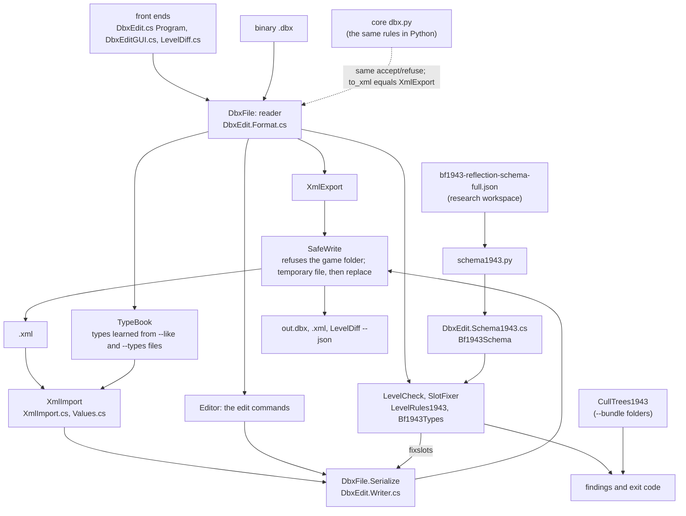

# DbxEdit: how it is built

This page is for developers who will change DbxEdit's code. To use the tools, read the [README](README.md). For the
binary format and what every command does to a file, read [FORMAT.md](FORMAT.md). Section numbers below are
FORMAT.md's.

## Overview

DbxEdit reads and writes binary `.dbx` partitions, BF1943's and BFBC2's alike. A partition is a string table plus a
tokenised tree of elements. DbxEdit's code is 13 C# source files in namespace `Bfbc2Dbx`, listed in
[`DbxEdit.rsp`](DbxEdit.rsp). Three programs compile that same list:
- `DbxEdit.exe`, the command line;
- `DbxEditGUI.exe`, the window (adds `DbxEditGUI.cs`);
- `LevelDiff.exe`, in [`bf1943-diff-workbench/level-diff`](../bf1943-diff-workbench/level-diff/README.md) (adds
  `LevelDiff.cs`).

The three programs share one reader, one writer and one way to write files. The reader accepts exactly what core's
Python reader [`dbx.py`](../core/bfbc2core/dbx.py) accepts, and the XML export matches `dbx.to_xml` character for
character. A file that is read and written again without an edit comes out byte for byte the same. Every output goes
through `SafeWrite`, which refuses the game folder. Core's [`csbuild.py`](../core/bfbc2core/csbuild.py) rebuilds an
exe whenever it is not built from the current sources.

## Data flow

## Module map

| File | Responsibility | Key entry points |
|---|---|---|
| `DbxEdit.cs` | the command line: one front end per command, exit codes | `Program.Main`, `Run`, `Xml`, `Roundtrip`, `Edit`, `Import`, `Check`, `FixSlots`, `Binary` |
| `DbxEdit.Format.cs` | reading: varints, `Element`, the string table, `DbxFile` | `new DbxFile(bytes)`, `DbxFile.Read(path)`, `Instances`, `Get`, `Intern`, `Walkable`, `MaxEditDepth` |
| `DbxEdit.Writer.cs` | writing a `DbxFile` back to bytes | `DbxFile.Serialize` |
| `DbxEdit.XmlExport.cs` | binary to XML (section 3) | `XmlExport.Convert`, `ValueText` |
| `DbxEdit.XmlImport.cs` | XML to binary (section 6): the XML reader, matched to the reference file | `XmlImport.Import(xml, reference, typeFiles, out report)`, `Guesses` |
| `DbxEdit.Values.cs` | value typing: `TypeBook`, and the typing half of `XmlImport` | `TypeBook.Learn`, `Find`; `XmlImport.EncodeValue`, `Notes` |
| `DbxEdit.Editor.cs` | the edit commands (section 5) | `Replace`, `ReplacePrefix`, `Drop`, `DropField`, `SetByte`, `SetField`, `SetPartitionGuid`, `AddItem`, `CopyField`, `Graft` |
| `DbxEdit.LevelCheck.cs` | the level check, BFBC2's rules, cull slots (section 7) | `LevelCheck.Detect`, `Run`; `SlotFixer.Fix`; `PlacedObject` |
| `DbxEdit.LevelRules1943.cs` | BF1943's rules and its reflected classes | `LevelRules1943.Check`, `Bf1943Types.IsA`, `Find`, `FieldClass`, `EnumValues` |
| `DbxEdit.CullTrees1943.cs` | BF1943's static cull trees, with `--bundle` (the other half of `LevelRules1943`) | `LevelRules1943.CheckCullTrees` |
| `DbxEdit.Schema1943.cs` | generated data: classes, structs, enums and members, as strings | `Bf1943Schema.Types` |
| `DbxEdit.SafeWrite.cs` | every file write | `SafeWrite.Bytes`, `Text`, `GameFolder`, `InGameFolder`, `WriteRefusedException` |
| `DbxEdit.ToolLog.cs` | the log and error reports, as core `errors.py` keeps them | `ToolLog.Start`, `Info`, `Warn`, `Fail`, `Explain` |
| `DbxEditGUI.cs` (not in the list) | the window; calls the classes above | `Bfbc2Dbx.Gui.GuiProgram`, `MainWindow.Edit`, `EditHistory` |
| `schema1943.py` | rewrites the generated block in `DbxEdit.Schema1943.cs` | `main` |

## How the parts fit

**Reader.**
- `DbxFile(byte[])` parses the 24-byte `{binary}` header, the string table and the element tree (sections 1 and 2).
- Every count, offset and varint is checked before use. A damaged file throws `InvalidDataException` with the offset,
  where `dbx.py` raises `ValueError` for the same file.
- Each `Element` keeps its raw payload bytes, so numbers keep their exact width.
- `DbxFile.Read(path)` adds the path to the message.
- `Walkable` refuses files nested more than `MaxEditDepth` (1,000) levels deep for edit, check, import and LevelDiff.
  `xml` and `roundtrip` take any depth, because they walk the tree iteratively.

**Writer.** `Serialize` keeps the original string area and offsets unless `TableChanged`. It writes the tree from its
elements. So an unedited file comes out unchanged, and an edit changes only what it touches (section 4). `roundtrip`
is the check: it reads and writes every file and reports any that differ.

**XML export and import.**
- `XmlExport.Convert` writes the format of section 3. Its `WholeNumberFields` list is the same as `dbx.py`'s
  `WHOLE_NUMBER_FIELDS`.
- `XmlImport.Import` parses the XML with its own small parser, `TextParser`, which refuses NUL characters.
- It matches each element to the reference file (`--like`, or the `.dbx` next to the XML). An unchanged value keeps its
  exact bytes. A changed value takes the reference's type.
- New elements are typed from a `TypeBook` learned from the reference and the `--types` files. Anything still unknown
  is guessed from the text and listed in `Guesses`, and the command exits 3.

**Value typing.** `TypeBook` records the element kind, number width, float or integer, and bool or byte first byte for
each `tag/first attribute value`. `XmlImport.EncodeValue` gives the bytes for a new text of an existing element, typed
as that element is stored. `setfield` and the window both use it. A decimal field stays decimal, an integer field
takes only integers, and a value that does not fit is refused (`InvalidDataException`). `Notes` collects what was
rounded or changed kind.

**Editor operations.** `Editor` wraps one `DbxFile` and changes its table and tree in place. Each method returns a
count or a success flag, and `Program.Edit` prints it. `Program.Edit` applies its commands in order, reads `@file`
command lists, and checks each command's argument count against its `Usage` table. It writes once, at the end.

**Level checks and cull trees.**
- `LevelCheck.Detect` picks the rule set. If the `LevelData` has BFBC2-only fields, it uses BFBC2's rules; otherwise
  BF1943's. `--rules` overrides it.
- `LevelCheck.Run` walks every instance for empty object-list entries, world objects without their parts, and
  references. With `--bundle`, it resolves references into other partitions through a folder index (`BundleIndex`).
- For BF1943 it then calls `LevelRules1943.Check`, the rules all five shipped levels satisfy, and with `--bundle`
  also `CheckCullTrees`.
- `Bf1943Types` loads `Bf1943Schema.Types` on first use. It answers "is class A a B?", "what class must this member
  point to?" and "which values does this enum have?".
- `SlotFixer.Fix` (`fixslots`) copies cull slots from another level. It matches objects by GUID, then by blueprint and
  position, then by nearest within 50 m.

**SafeWrite.** `SafeWrite.Bytes` and `Text` are the only way any of the three programs writes a file.
- `GameFolder` applies core `game1943.find_game`'s rule step for step (since 2026-11-06):
  - the candidates, in order: `BF1943_GAME` when set and not empty, then the Xenia kit's `dist\xenon` under the suite
    the exe was built in (find_game's suite is the one `game1943.py` sits in);
  - a candidate counts when `<candidate>\levels`, joined as `os.path.join` does, opens through Windows as a folder,
    links and junctions followed (`os.path.isdir`). The path goes to Windows as written: no .NET path function
    rewrites it first;
  - the first that counts is returned spelled as `os.path.abspath` spells it (`AbsPath`: `GetFullPathNameW`, then no
    trailing separator). `\\?\`, 8.3 short names, upper case and junction names are kept as given.
  - Before 2026-11-06 `Directory.Exists` and `Path.GetFullPath` decided. A `\\?\` spelling, which find_game takes, was
    passed over, so the kit's folder (or none) was protected instead. A space before `\levels` was trimmed, so a folder
    find_game passes over was protected.
- The folder is looked up again for every write, as find_game is for every check. It was once per process, so a
  window opened before the game folder existed never protected it.
- `InGameFolder` resolves links and junctions and compares folder identities, so other casings, short names,
  junctions and shares are caught too. It walks the folders above the target both as written and resolved;
  `fbrb1943.contains` walks only the resolved ones. So a junction inside the game folder that leads out of it is
  refused here and allowed there. That is the one deliberate difference: SafeWrite is the stricter of the two.
- A `\\?\` target is written by its plain path (the .NET Framework 4 file functions refuse the prefix), and the guard
  checks that very path. Before 2026-11-06 such a target failed with exit 2 wherever it lay.
- A write goes to a `~xxxxxxx.tmp` file beside the target, is flushed, and then `MoveFileEx` replaces the target. A
  failed write deletes the temporary file and leaves the old one in place. A hard link at the target loses only its
  name.

**Command front end.**
- `Program.Main` starts `ToolLog`, then dispatches on the first argument: `xml`, `roundtrip`, `edit`, `import`,
  `check` or `fixslots`.
- Exit codes:

  | Code | Meaning |
  |---|---|
  | 0 | done |
  | 1 | failed, or `check` found errors |
  | 2 | bad usage, or the command could not run (a damaged or missing file, a refused write; `ToolLog.Fail`) |
  | 3 | `import` had to guess some types |

- `ToolLog` writes `%LOCALAPPDATA%\bf1943-tool-suite\logs\<tool>-<date>.log` and keeps the 20 newest.

**Window (`DbxEditGUI.cs`).** `MainWindow` holds the open `DbxFile` and an `EditHistory`: the undo stack (each edit's
document before it, as bytes), the edit script (each edit's DbxEdit command, or a `#` comment when it has none) and the
undo depth the file on disk holds (`savedAt`, so an undo past a save marks the document modified).
- Every edit goes through `MainWindow.Edit(apply)`, one transaction (`EditHistory.Run`): the document is serialized,
  `apply` changes it (in place through `Editor`, or by replacing it, as an XML import does) and returns the edit's
  script line, or null when it changed nothing. With a line, the snapshot and the line are recorded together. With
  null, nothing is recorded. When `apply` throws, the document becomes the snapshot again, the tree is rebuilt from it,
  nothing is recorded and the exception goes on (to "Value not accepted", "Import failed" or the window's error
  report). So the undo stack and the script always hold the same edits (2026-11-05: Drop or Graft throwing after the
  snapshot left an undo state without a script line).
- `Undo` pops a state and its script line together (`EditHistory.Undo`). Opening a file starts a new `EditHistory`;
  a file that cannot be opened leaves the old document and its history.

## Building: build.bat, LevelDiff and csbuild

- **`build.bat`** makes this folder the current folder (csc reads the response file's names relative to it). It runs
  the .NET Framework 4 compiler twice:
  - `@DbxEdit.rsp` gives `DbxEdit.exe`;
  - `DbxEditGUI.cs @DbxEdit.rsp` with `-main:Bfbc2Dbx.Gui.GuiProgram` gives `DbxEditGUI.exe`.
- **LevelDiff's `build.bat`** changes to this folder (or to `DBX_TOOLS`) and compiles its own `LevelDiff.cs` with
  `@DbxEdit.rsp` and `-main:LevelDiff`. LevelDiff uses `DbxFile.Read`, `Walkable`, `XmlExport.ValueText`,
  `SafeWrite.Text` (for `--json`) and `ToolLog`.
- **`core/bfbc2core/csbuild.py`** reads `DbxEdit.rsp` (`dbx_sources`) to know what each exe is built from.
  `tools()` maps `dbxedit`, `dbxgui` and `leveldiff` to their exe, `build.bat` and sources. `ensure(name)` rebuilds
  the exe when any of these is true:
  - it is missing;
  - it is older than a source, `DbxEdit.rsp` or its `build.bat`;
  - the SHA-256 of those files differs from the one recorded at its last build in `<exe>.sources` (git-ignored).

  The hub and the tests get their exes only through `csbuild`.
- **The reader's two copies.** `core/bfbc2core/dbx.py` is the reader in Python. Other tools read partitions with it,
  and `to_xml` is DbxEdit's XML. The C# reader's comments name the `dbx.py` rule each check follows. A change to either
  reader goes into both and into FORMAT.md. The tests below catch any difference.

## Key invariants

- **Byte-identical round trip.** Anything an edit does not change is written back as it was read. `DbxEdit roundtrip`
  and the BF1943 tier check it on every Wake Island partition.
- **The C# reader and `dbx.py` agree.** They accept and refuse the same files, and `XmlExport.Convert` equals
  `dbx.to_xml`.
- **The game folder is never written.** `SafeWrite` refuses it, whether reached directly, through a junction, a share,
  an 8.3 or `\\?\` spelling or under another casing. It finds the folder by core `game1943.find_game`'s rule, so the
  C# and Python tools protect the same folder.
- **Writes are atomic.** A failed write leaves the old file and no temporary file behind.
- **No stale exes.** `csbuild.ensure` refuses to hand out an exe built from other sources. Every `DbxEdit.*.cs` in this
  folder must be listed in `DbxEdit.rsp`, and the rsp must list nothing else.
- **The generated schema is not edited by hand.** `schema1943.py` replaces only the block between
  `BEGIN GENERATED BF1943 SCHEMA` and `END GENERATED BF1943 SCHEMA`. It records the schema file's SHA-256 and the
  executable's.

## Tests

| File | Tier | Guards |
|---|---|---|
| `tests/test_csharp_tools.py` | quick | `csbuild`'s rebuild reasons (on a fake tool); the rsp names every source and each `build.bat` compiles it; builds DbxEdit and LevelDiff; then runs `csharp_regressions.py` |
| `tests/csharp_regressions.py` | (run by the above) | the reader against `dbx.py` (refusals, exit codes, equal XML); nesting limits; SafeWrite (a made-up `BF1943_GAME`, casing, junctions, hard links, failed writes); the game lookup against `find_game` on every spelling of `BF1943_GAME` and of the target (`check_game_lookup`); edit commands and their usage errors; the level check and `fixslots`; LevelDiff; DbxEditGUI through reflection |
| `tests/test_levelcheck1943.py` | bf1943 | the five shipped levels pass BF1943's rules; `--bundle` references and cull trees; 25 broken copies of Wake Island and five of its cull tree fail with their rule's message; rule detection; `fixslots` |
| `../tests/test_bf1943_tools.py dbxedit` | bf1943 | every Wake Island partition round-trips byte for byte; the XML equals `dbx.py`'s; the level check passes; LevelDiff finds no change between a file and itself |
| `../core/tests/test_game_folder_spellings.py` | quick | the Python side of the same rule: `find_game` and the fbrb tool's guard on every spelling of a made-up game folder |
| `../core/tests/test_dbx_malformed.py`, `../core/tests/test_fuzz_core.py`, `../tests/test_fuzz_real.py` | quick, quick, bf1943 | `dbx.py` on damaged files, fuzzed on made-up files and on your partitions |

## Where to start

**Add an edit command.**
1. Write the operation as an `Editor` method.
2. Add its `case` and `Usage` entry in `Program.Edit` (`DbxEdit.cs`), and its line in the usage text.
3. Add it to the window's menus in `DbxEditGUI.cs` if the window should offer it.
4. Describe it in FORMAT.md section 5, and add a `check_*` group to `tests/csharp_regressions.py`.

**Add or change a BF1943 level rule.**
1. Put rules on a single partition in `LevelRules1943.Check`, and rules that need the cull trees in
   `CullTrees1943.cs`.
2. Keep the five shipped levels at 0 errors and 0 warnings.
3. Add a broken copy that the rule catches to `tests/test_levelcheck1943.py`, and describe the rule in FORMAT.md
   section 7.
4. If the rule needs more of the executable's schema, regenerate it with `schema1943.py` instead of editing
   `DbxEdit.Schema1943.cs`.

**Change how the format is read, or add a source file.**
1. Change `DbxEdit.Format.cs` and `core/bfbc2core/dbx.py` together, and update FORMAT.md sections 1 and 2.
2. Run `tests/test_csharp_tools.py`, `core/tests/test_dbx_malformed.py` and the bf1943 tier's `dbxedit` test.
3. A new file named `DbxEdit.<Part>.cs` goes into `DbxEdit.rsp`. `test_csharp_tools.py` fails until it is listed.
