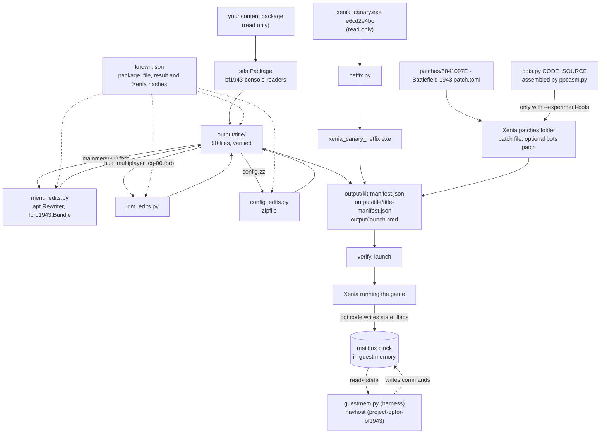

# BF1943 Xenia kit: how it is built

This page is for developers who will change the kit's code. To use the kit, and for what each change does in the
game, read the [README](README.md).

## Overview

`xeniakit.py` turns your own BF1943 content package into a Xenia setup that plays offline. Nothing is downloaded and
no game data is shipped. A build makes these changes:
- It extracts the package and checks each 4 KB block's SHA-1 and each file's SHA-256 against `known.json`.
- It edits three of the extracted files: the main menu movie, the in-game menu movie and `config.zz`.
- It copies a Xenia patch file into Xenia's `patches` folder.
- It writes a copy of `xenia_canary.exe` with its UDP byte-order bug fixed.
- It writes manifests of everything it made. `verify` re-checks the build against them, and `launch` verifies and then
  starts Xenia.

Each edit is checked against the hash of a result that was tested in game, so the kit refuses to guess. It refuses
another package, another Xenia build, or a result that differs.

`--experiment-bots` adds a second patch file. `bots.py` writes it: PowerPC code, assembled by `ppcasm.py` into an
unused code cave and called from a hook in the server's player update. That code adds 23 server-side bots and talks to
a program outside Xenia through a mailbox in guest memory. Two programs use the mailbox: `guestmem.py` in the test
harness, and navhost in project-opfor-bf1943.

## Data flow

`build` runs in five numbered stages (`xeniakit.build`). The paths it refuses come first: an output that is not
empty, a missing `xenia_canary.exe`, a path `launch.cmd` cannot name, a package or Xenia with an unknown hash, and a
foreign file under the bots patch's name.

## Module map

| File | Responsibility | Key entry points |
|---|---|---|
| `xeniakit.py` | the command line; extract, edit, install, manifests, verify, launch | `build`, `extract`, `verify`, `launch`, `install_bots_patch`, `kit_bots_patches`, `launcher_text`, `safe_join` |
| `known.json` | the release's package and per-file hashes, the expected edit results, the Xenia build and netfix hashes, the patch file's hash | read as `KNOWN` |
| `menu_edits.py` | main menu movie (`Menu/main_nav.res`, `Menu/main_root.res` in `mainmenu-00.fbrb`) | `build`, `main_menu`, `host_list_is_local`, `no_autosave_notice`; helpers `constant_namer`, `retarget`, `check_targets` |
| `igm_edits.py` | in-game menu movie (`Menu/igm_mp_cq.res` in `hud_multiplayer_cq-00.fbrb`) | `build`, `team_selector`, `frontline_without_leaderboards`, `no_gamer_card`, `force_team` (experiment) |
| `config_edits.py` | `GameSettings.cfg` inside `config.zz`: the two network ports | `build`, `PORTS` |
| `patches/5841097E - Battlefield 1943.patch.toml` | Xenia's patch file: signed-in state, no network, no automatic team (`be32` words by address) | copied, after its hash is checked |
| `netfix.py` | NOPs over five byte swaps in Xenia's `sendto`, `WSASendTo` and `recvfrom` | `build`, `SITES`, `file_offset` |
| `bots.py` | the bots experiment: guest code, data and mailbox layout, its patch file, and Python models of the locked reads and writes | `build`, `patch_toml`, `CODE_SOURCE`, `assembler_symbols`, `guest_command`, `guest_record`, `host_record`, `MAILBOX_NAMES` |
| `ppcasm.py` | a small two-pass PowerPC assembler for the instructions `bots.py` uses; anything else is an `AsmError` | `assemble` |
| `../bf1943-automated-map-and-bot-test-harness/xenia-run/guestmem.py` | attaches to Xenia and reads and writes the mailbox | `Guest`, `block_of`, `bot_record`, `flag_records`, `write_command`, `drive` |

The APT movie reader and rewriter (`apt.py`) come from `bf1943-apt-tools`. The bundle reader and writer
(`fbrb1943.py`) come from `bf1943-fbrb-tool`. Both are shared folders (`core/suitepath.py`).

## The parts

**Menu and in-game menu edits.** The two `build` functions work the same way:
1. Read the movie from its bundle (`fbrb1943.Bundle.data`) and refuse an original that does not validate.
2. Rewrite action blocks with `apt.Rewriter`. Each edit finds its block by address or by owner and checks the
   instruction shapes it expects. It rewrites the instruction list, points branches at the new instructions
   (`retarget`), refuses a branch into a removed instruction (`check_targets`), and moves the item to the new code
   (`rw.repoint`).
3. Validate the new movie, rebuild the bundle, and read every entry back.

`igm_edits` also adds sprites, characters and placements for the CHOOSE YOUR SIDE window. It builds that window's
ActionScript from small code builders (`var`, `call`, `set_member`, `if_else`).

**Config edits.** `config_edits.build` rewrites the ZIP entry by entry and keeps each entry's header fields. It
changes exactly one line for each port and refuses any other count. It then re-reads the archive, checks the CRCs,
and compares every other entry.

**Patch file and netfix.** The patch file is a fixed file in this folder, made in operation-rising-sun from words
verified against the decoded image. The build checks its SHA-256 before copying it. If Xenia already has a file with
other contents under that name, the build refuses unless `--replace-patch` is given. `netfix.build` maps each virtual
address to a file offset through the PE section table and checks the original bytes before it writes the NOPs, so
another Xenia build is refused. The build keeps an identical `xenia_canary_netfix.exe` that is already there, because
Xenia may be running it.

**The bots experiment.**
- **Where the code goes.** The code, the bot table and the names go in a code cave at `CODE` (0x82AAA1C0, 0xE40
  bytes). The hook replaces the `bl` at `HOOK` (0x82391988) with a `bl` to the cave. The cave first makes the original
  call, then handles the bots.
- **How it is assembled.** `bots.build` assembles `CODE_SOURCE` twice. The first pass gives the code's size. The
  second places the table right after the code. The bot names and kit names are laid out as the game's
  `{begin, end, capacity}` strings.
- **The data area.** `DATA` (0x82D26E10, 0x1F0 bytes) holds:

  | Offset | Holds |
  |---|---|
  | `STATE`, `MANAGER`, `TICK` | the code's state, the match's player manager, the tick |
  | `SLOTS` | one player slot per bot |
  | `HANDLE` | the kit lookup's handle |
  | `MBOX_MAGIC`, `MBOX` | the mailbox's magic and address |
  | `HOST_PLAYER`, `HOLD` | which match the bots belong to; not part of the mailbox |

  The data area uses 0x90 bytes in all.
- **The mailbox.** It is allocated once per match with the game's allocator, `ALLOC_SIZE` 0xD40 bytes, laid out as
  big-endian words:

| Part | Offset | Contents | Lock |
|---|---|---|---|
| header | 0x00 | `H_MAGIC` `RSM2`, `H_VERSION` 2, counts and sizes, `H_MANAGER`, `H_TICK` (0x1C), `H_FLAGS` (0x20) | none: `H_FLAGS` then `H_TICK`, with `lwsync` between |
| bot state record | `BOT0` 0x40 + 0x40 × slot, `R_*` 0x00 to 0x1C | tick, player, soldier, team, x, y, z, tick | two ticks: the guest writes `R_SEQ`, `lwsync`, the fields, `lwsync`, `R_SEQ_END` |
| bot command record | same slot, `C_*` 0x20 to 0x3C | stamp, throttle, strafe, yaw, pitch, buttons high and low, `C_SEQ` | sequence: the host makes it odd, writes, then makes it even and new |
| capture point record | `FLAG0` 0x600 + 0x30 × k, up to 8 | tick, entity, owner, control, enabled, radius, x, y, z, tick (`F_SEQ_END` 0x2C) | two ticks, as the state record |
| guest-only copies | `BLOCK_SIZE` 0x780 + 0x40 × slot | each bot's last whole command | the guest's own; hosts never see it |

  - **Reading the state and flag records.** A host reads the closing tick, then the fields, then the opening tick. It
    takes the record only when the two ticks are equal (`bots.host_record`, up to `TRIES` reads).
  - **Reading the command record.** The guest reads `C_SEQ`, the record and `C_SEQ` again. It takes the record only
    when both reads give the same even value (`bots.guest_command`, `TRIES` 4 times). If no read is whole, it uses the
    bot's last whole command. Any command whose stamp is 0, or older than `STALE` (10) ticks, gives a neutral frame,
    so the bots stand still when the host stops.
  - **Matching the match.** Each tick the code compares the match with the one it recorded: the player manager, the
    first player (`HOST_PLAYER`), and each bot still in the player list. When the match has changed, it forgets the
    bots, `MBOX` and its magic. When the host has left, `HOLD` stops it from making new bots until the player list
    empties or the manager changes.

**The host programs.** `guestmem.py` finds Xenia's guest memory. It accepts a base address only where guest
`0x82000000` starts with `MZ`. It then checks that the bot code is in place and that the hook branches to it. It
reads the mailbox through `MBOX`. `write_command` writes three times: the odd sequence, then the stamp and fields in
one write, then the even sequence. While a command is held, `drive` keeps rewriting the stamp. navhost (in
project-opfor-bf1943 `TnT/Code/Engine/AI/Bots/navhost`) is the real host. Its `src/rsmbox.h` is a copy of
`MAILBOX_NAMES`, and its own tests check it against `bots.py`.

**verify and launch.** `verify` compares these with their recorded SHA-256:
- every title file, against `title-manifest.json`;
- the fixed Xenia, the patch file and the bots patch (if one was built), against `kit-manifest.json`.

It then checks the build's bot mode. A normal build allows no kit-made bots patch in Xenia's folder (found by its
`bots.HEADER` first line, under any name). A bots build allows only its own. `launch` runs `verify`, then starts
`launch_args` from the fixed Xenia's folder. `launch.cmd` is UTF-8 and switches the console to code page 65001 for the
lines that name paths (`launcher_text`).

## Key invariants

- **Inputs are only read.** The package and `xenia_canary.exe` are opened for reading. `extract` writes with
  `open(..., 'xb')` into a title folder that must be empty, and `safe_join` refuses any package path that would leave
  that folder.
- **Byte-identical results.** The build refuses unless these SHA-256s match `known.json`:
  - the package;
  - each extracted file;
  - each edited resource: `main_nav.res`, `main_root.res`, `igm_mp_cq.res` (not with `--experiment-team`) and
    `GameSettings.cfg`;
  - the kit's patch file and the fixed Xenia.

  The rebuilt bundles and `config.zz` are recorded in `title-manifest.json` but not pinned in `known.json`.
- **Bot mode is all or nothing.** `install_bots_patch` leaves exactly zero kit bots patches (a normal build) or
  exactly one, its own (a bots build). It refuses a foreign file under the kit's name before writing anything, and
  `verify` enforces the same rule.
- **Mailbox locks.** The state and flag records use two ticks, written in a fixed order with `lwsync`, and readers
  compare the closing tick with the opening one. Commands use an even/odd sequence with a stale-stamp limit. The
  layout and version 2 stay fixed: the guest-only copies and `HOLD` sit outside the host-visible block.
- **The bot code fits.** `bots.build` raises when the blob passes `CODE_END` or the data passes `DATA_END`, and when
  the two assembler passes disagree on the code's size. `ppcasm` refuses unknown mnemonics, wrong operand counts and
  r0-based `addi`/`addis`/loads and stores.

## Tests

| File | Tier | Guards |
|---|---|---|
| `tests/test_xeniakit.py` | quick | `known.json` and the patch file, the port edit on a built ZIP, netfix on built PE files, verify's bot mode, `install_bots_patch`, `launch.cmd` under code pages 437 and 65001 |
| `tests/test_xeniakit.py --game` | bf1943 | a full build from your package against a scratch Xenia folder; verify accepts it and notices a changed file; your Xenia folder is unchanged |
| `tests/test_xeniakit_build.py` (pytest-style) | quick | `build`, `verify` and `launch` on a made-up package and Xenia, with every refusal |
| `tests/test_menu_igm_edits.py` (pytest-style) | quick | both movie edits on made-up movies and bundles, and their refusals |
| `tests/test_ppcasm.py` | quick | each encoding against capstone; `la`/`li32`; operand counts |
| `tests/test_bots.py` | quick | the code fits and the hook branches; capstone decodes the mailbox accesses as the layout names them; an interpreter runs the command read, the record writes and the match cases against `guest_command`, `host_record` and `guest_record` |
| `tests/test_bots.py --image` | bf1943 | the same against the decoded BF1943 image (its SHA-256 first) |
| `../bf1943-automated-map-and-bot-test-harness/xenia-run/tests/test_guestmem.py` | quick | guestmem on a made-up guest: attach, snapshot, the locked writes and reads wherever the other side's accesses land |
| `.../xenia-run/tests/test_guestmem_process.py` (pytest-style) | quick | guestmem's process access on the test's own process (never Xenia), and its other command-line paths |

## Where to start

**Change a menu.** Start in `menu_edits.py` or `igm_edits.py`, and use `bf1943-apt-tools` to disassemble the movie.
1. Add an edit function that finds its block and checks the shapes it expects, then call it from `build`.
2. Add a made-up movie case to `tests/test_menu_igm_edits.py`.
3. Test the change in game.
4. Record the new result's hash in `known.json` (`expected`). Until you do, `build` refuses it.

**Change the bots' guest code.** Edit `CODE_SOURCE` in `bots.py`. If you need an instruction `ppcasm.py` lacks, add it
there with a capstone check in `test_ppcasm.py`.
1. Keep the room it reports. `test_bots.py` tells you whether the code still fits.
2. If the mailbox changes, change the `MAILBOX_NAMES` constants and `VERSION`, then `guestmem.py` and navhost's
   `rsmbox.h` in the same change.
3. Extend the interpreter cases in `test_bots.py` for any new locked read or write.

**Support another Xenia or game build.** Every address here is tied to one build. That covers `netfix.SITES`, the patch
file's words, and the `bots.py` hook and cave (module hash `872BBE31C0FBA21B`). Find the new sites, then update
`known.json` (`xenia`, `game`) together with them.
